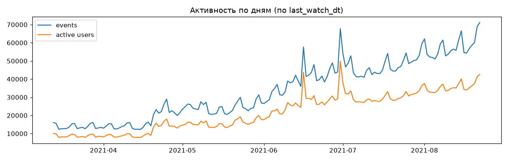
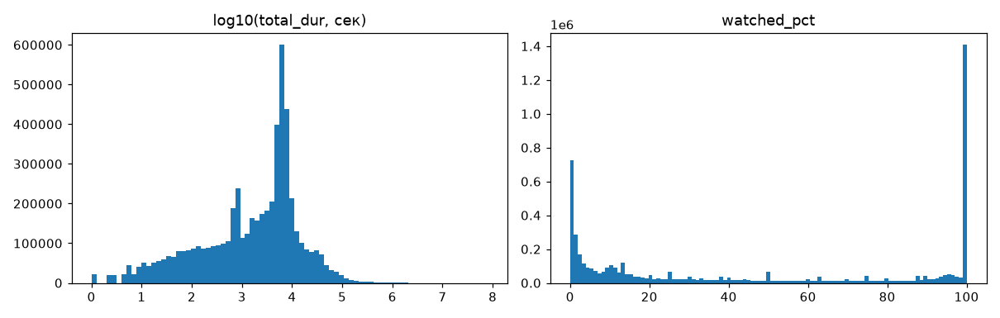
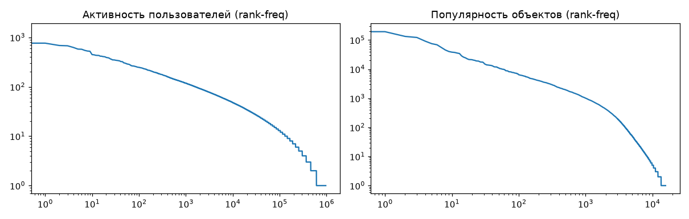

# Рекомендательная система на датасете KION (МТС)

> **Статус:** этапы 1, 2 и 3 готовы:
> 1. EDA и исследование доменных данных
> 2. Базовый двухэтапный пайплайн (Pop7 + ItemKNN candidates → 33 признака → LightGBM LambdaRank)
> 3. Модуль AutoFeat: автогенерация признаков (Human vs Brute-force vs AI-Agent), 3-этапный отбор и валидация.

## Структура

```
t_bank/
├── data/
│   ├── interactions.csv, users.csv, items.csv   # исходники (не в git)
│   └── processed/*.parquet                      # кэш, создаётся автоматически
├── reports/
│   ├── eda_output.txt                           # полный текстовый отчёт EDA
│   ├── eda/*.png                                # графики
│   ├── base_ranker.md                           # отчёт базового ранжировщика LightGBM
│   └── feature_search.md                        # отчёт исследования автогенерации признаков
└── src/
    ├── data.py                                  # загрузка + кэширование
    ├── eda.py                                   # разведочный анализ
    ├── split.py                                 # temporal train/val/test сплит (dt < T)
    ├── candidates.py                            # генераторы кандидатов: Pop7 + ItemKNN
    ├── features_base.py                         # 33 базовых признака
    ├── metrics.py                               # Recall, MAP, NDCG@10, Coverage, bootstrap CI
    ├── train_base.py                            # обучение LightGBM lambdarank
    └── autofeat/                                # модуль автогенерации и отбора признаков
        ├── grammar.py                           # декларативная SQL-грамматика признаков
        ├── compiler.py                          # векторизованный DuckDB/Polars компилятор
        ├── generators.py                        # авторы: Human, Brute-force, AI-Agent
        ├── selector.py                          # 3-этапный отбор (фильтры, null imp, forward)
        └── run_search.py                        # оркестратор исследования автогенерации признаков
```

## Запуск

```powershell
# 1. Разведочный анализ данных (EDA)
.venv\Scripts\python -m src.eda
cmd /c ".venv\Scripts\python -m src.eda > reports\eda_output.txt"   # сохранить отчёт в UTF-8

# 2. Обучение и бенчмарк базового ранжировщика LightGBM (5000 юзеров на сплит)
.venv\Scripts\python -m src.train_base --users 5000

# 3. Полное исследование AutoFeat (генерация, Null Importance, Forward-отбор, тест)
.venv\Scripts\python -m src.autofeat.run_search --users 1000 --max-steps 5

# Опции запуска run_search:
#   --users N        Число пользователей на срез (train/val/test, default: 2000)
#   --seed S         Случайное зерно генерации (default: 42)
#   --max-steps M    Максимальное число шагов forward-отбора (default: 5)
#   --k K            Размер топа рекомендаций для метрик (default: 10)
```

> [!NOTE]
> В Windows PowerShell 5 редирект `>` записывает файл в UTF-16 и портит кириллицу.
> Поэтому консольные отчёты сохраняются через `cmd /c` либо напрямую скриптами в UTF-8.

## Что сделано

### 1. Загрузка данных ([`src/data.py`](src/data.py))

- CSV читаются через **polars**, типы задаются явно (`Int32` для id, `Date` для дат).
  После первой загрузки данные кэшируются в parquet: CSV весит 180 MB, parquet 50 MB.
- `last_watch_dt` переименован в `dt`.
- Многозначные поля items (`genres`, `countries`, `studios`, `directors`, `actors`)
  разбиваются на списки, приводятся к нижнему регистру, пробелы обрезаются.

### 2. EDA ([`src/eda.py`](src/eda.py))

В скрипте 9 блоков: схемы и пропуски, время, распределения `total_dur` / `watched_pct`,
длинные хвосты, холодный старт и дрейф, бейзлайн по популярности, пользователи,
контент, косвенные связи «пользователь × атрибут».

#### Данные в цифрах

| | значение |
|---|---|
| interactions | 5 476 251 строк, **дублей пар (user, item) нет** |
| пользователи / объекты в interactions | 962 179 / 15 706 |
| период | 2021-03-13 … 2021-08-22 (163 дня) |
| плотность матрицы user×item | 3.6·10⁻⁴ |
| покрытие признаками: users / items | 77.4 % / 100 % |

#### Ключевые наблюдения

**Природа данных.** Одна строка соответствует одной паре (user, item) за весь период.
`dt` — дата *последнего* просмотра, `total_dur` и `watched_pct` накоплены к концу периода.
Из этого следует:
- повторных взаимодействий нет, поэтому уже просмотренное можно смело исключать из рекомендаций;
- в тестовое окно попадают и пары, которые начали смотреть раньше, а закончили в окне;
- признаки `total_dur` и `watched_pct` у тестовых пар считаются с учётом будущего,
  и использовать их как фичи нельзя: это утечка.

**Время.** Активность выросла примерно в 4.5 раза: 95 тыс. событий в неделю в марте,
424 тыс. в августе. Есть скачок в неделю 19.04 и пики 16.06 и 30.06.
Сезонность недельная, в выходные смотрят на ~20 % больше.
Часть роста объясняется тем, что `dt` — дата последнего просмотра:
старые пары «переезжают» на более поздние даты.



**Сила сигнала.** Медиана `total_dur` равна 48 мин, медиана `watched_pct` — 32 %.
Распределение `watched_pct` бимодальное: пики на 0 и на 100.
Порогам соответствуют такие доли строк:
`watched_pct ≥ 10` — 68 %, `≥ 50` — 44 %, `≥ 90` — 32 %.
У сериалов медиана `watched_pct` 13 % против 45 % у фильмов,
хотя по времени их смотрят дольше (80 мин против 42).
Скорее всего, процент для сериала считается от всего сериала, а не от серии.
Значит, единый порог по `watched_pct` занижает сериалы, и для них лучше брать `total_dur`.



**Длинные хвосты.**
- Пользователи: медиана 2 взаимодействия, у 36.9 % ровно одно, у 61.8 % не больше трёх.
- Контент: Gini популярности 0.905. Топ-10 тайтлов дают 18.7 % всех взаимодействий,
  топ-100 — 39.9 %, топ-1000 — 76.8 %.
  Лидеры: «Хрустальный» (202 тыс.), «Клиника счастья» (193 тыс.), «Гнев человеческий».



**Холодный старт.** Проверено на последних 4 неделях, каждая сравнивается со всей историей до неё:
- ~34–37 % активных пользователей недели раньше не встречались;
- холодных объектов всего ~2 %;
- «тёплые» пары (известны и пользователь, и объект) составляют ~70 % строк недели;
- топ-10 популярного недели совпадает с топ-10 предыдущей недели на 7–8 позиций из 10.

Вывод: нужна отдельная стратегия для холодных пользователей
(популярное плюс демография), а холодные объекты почти не важны.

**Бейзлайн «популярное за N дней».** Тестом служит последняя неделя (16–22.08),
оценка по 111 240 тёплым пользователям, уже просмотренное исключено:

| окно | Recall@10 | HitRate@10 |
|---|---|---|
| 1 день | 0.2098 | 0.3388 |
| 7 дней | **0.2102** | 0.3384 |
| 14 дней | 0.1938 | 0.3139 |
| 30 дней | 0.1847 | 0.3004 |
| весь период | 0.1635 | 0.2715 |

Короткое окно заметно лучше всей истории: популярность дрейфует.
Этот бейзлайн задаёт нижнюю планку для всех моделей.

**Признаки пользователей.** 4 категориальных поля: `age`, `income`, `sex`, `kids_flg`.
Пропуски ~1.7 %, у 22.6 % пользователей из interactions признаков нет совсем.

**Признаки контента.** 75 % фильмы, 25 % сериалы, медианный год выпуска 2014.
`for_kids` пуст на 96.5 %, `studios` — на 93 %: эти поля почти бесполезны.
Жанров 95, стран 91, режиссёров 8 834, актёров 61 854 (в среднем 10.5 на тайтл).

**Косвенные связи «пользователь × атрибут»** — потенциальные pair-признаки
для ранжирования. Доля тёплых тестовых пар, у которых значение атрибута
уже встречалось в истории пользователя:

| атрибут | доля |
|---|---|
| жанр | 0.866 |
| страна | 0.785 |
| актёр | 0.207 |
| режиссёр | 0.033 |
| студия | 0.001 |

Жанр и страна почти всегда совпадают, поэтому различают слабо, но полезны как фон.
Совпадения по актёрам реже и, вероятно, информативнее.

### 3. Базовый двухэтапный ранжировщик LightGBM ([`src/train_base.py`](src/train_base.py))

Реализован классический двухэтапный промышленный пайплайн рекомендаций с temporal-валидацией:
1. **Генерация кандидатов ([`src/candidates.py`](src/candidates.py)):**
   - **Pop7:** топ-30 популярных фильмов за последние 7 дней (дрейф популярности).
   - **ItemKNN:** совместная встречаемость (co-occurrence) айтемов в истории пользователя за всё время до момента сплита $T$, отфильтрованная по окну кандидатов (до 50 айтемов на пользователя).
   - Исключение уже просмотренного пользователем до даты отсечки $T$ (`dt < T`).
   - Итоговый пул кандидатов: в среднем ~65 кандидатов на пользователя с суммарным **Candidate Recall@65 ~ 34.8%** на отложенном тесте.

2. **33 базовых признака ([`src/features_base.py`](src/features_base.py)):**
   - Кандидатные ранги: `pop7_rank`, `knn_rank`, `knn_score`.
   - Профиль пользователя: счётчики и суммы просмотров (окна 7/14/30 дней и всё время), средняя длительность, средний процент досмотра, recency (`u_days_since_last`).
   - Профиль объекта: активность просмотров (7/14/30 дней и всё время), тренд популярности `i_pop_trend_7_30`, средний % досмотра.
   - Пользователь × Контент (cross-features): совпадения по жанрам (`u_genre_match_cnt`, `u_genre_match_share`), странам и актёрам.
   - Демография пользователя: `age`, `income`, `sex`, `kids_flg`.

3. **Обучение и результаты на отложенном тесте (`n_users=5000` на сплит, [`reports/base_ranker.md`](reports/base_ranker.md)):**

| Модель | Recall@10 | MAP@10 | NDCG@10 | HitRate@10 | Catalog Coverage |
|---|---|---|---|---|---|
| Популярное за 7 дней | 0.2124 | 0.0878 | 0.1324 | 0.3358 | 0.0019 |
| ItemKNN | 0.1856 | 0.0848 | 0.1244 | 0.3104 | 0.1431 |
| **LightGBM (LambdaRank)** | **0.2243** | **0.1039** | **0.1496** | **0.3616** | **0.0509** |

- **Статзначимость (парный бутстреп, 95% ДИ):**
  - LightGBM vs Pop7: $\Delta\text{NDCG@10} = \mathbf{+0.0172}$ `[+0.0133, +0.0214]` (статистически значимо)
  - LightGBM vs ItemKNN: $\Delta\text{NDCG@10} = \mathbf{+0.0252}$ `[+0.0205, +0.0297]`
- **Топ-3 драйвера ранжирования по Gain:** `knn_rank` (28.9%), `pop7_rank` (28.5%), `i_cnt_7d` (15.3%).

---

### 4. Автогенерация и 3-этапный отбор признаков: AutoFeat ([`src/autofeat/run_search.py`](src/autofeat/run_search.py))

Модуль автоматизирует полный цикл Feature Engineering: декларативное описание гипотез, компиляцию, фильтрацию от шума и жадный forward-отбор.

#### 1. Архитектура генераторов (`src/autofeat/generators.py`)
Сравниваются три различных подхода к созданию признаков:
- **Human (доменный инженер):** экспертные эвристики на основе соревновательного опыта KION (темп досмотра, месячные объёмы, доли успешных завершений).
- **Brute-force (систематический перебор грамматики):** комбинаторный перебор окон (3d, 7d, 14d, 30d, all) и математических агрегатов (`mean`, `sum`, `max`, `std`) по базовым полям `total_dur`, `watched_pct` и событиям.
- **AI-Agent (гипотезы на основе EDA):** целенаправленные гипотезы, вдохновлённые выводами EDA (бимодальность `watched_pct`, порог досмотра сериалов, всплески недавней активности).

Векторизованный Polars-компилятор ([`src/autofeat/compiler.py`](src/autofeat/compiler.py)) компилирует свыше 55 кандидатов за **~1.0 секунду**.

#### 2. Защита от переобучения и утечек (3-этапный селектор [`src/autofeat/selector.py`](src/autofeat/selector.py))
1. **Дешёвые фильтры:** отсечение квазиконстантных признаков ($Var < 10^{-6}$), пропусков $>50\%$ и коллинеарных дубликатов с $|r| > 0.98$ (отсеяно 5 кандидатов).
2. **Null Importance:** обучение легковесной модели на оригинальных признаках и признаках с рандомизированным таргетом. Проходят только признаки, у которых реальный прирост Gain статистически значимо выше случайного шума (отсеяно 44 шумовых признака из 52).
3. **Forward Selection на валидации:** пошаговый жадный отбор по NDCG@10 с контролем ранней остановки при $\Delta < 0.0001$.

#### 3. Сравнение авторов признаков (Validation, до отбора)

| Группа признаков | Число признаков | NDCG@10 | Recall@10 | MAP@10 | HitRate@10 | Δ NDCG |
|---|---|---|---|---|---|---|
| Base (33 features) | 33 | 0.1330 | 0.2127 | 0.0860 | 0.3580 | +0.0000 |
| Base + Human | 44 | 0.1321 | 0.2081 | 0.0849 | 0.3550 | -0.0009 |
| Base + BruteForce | 69 | 0.1299 | 0.2033 | 0.0848 | 0.3390 | -0.0031 |
| **Base + AIAgent** | **43** | **0.1338** | **0.2147** | **0.0860** | **0.3570** | **+0.0008** |
| Base + All Generated | 90 | 0.1327 | 0.2006 | 0.0887 | 0.3400 | -0.0003 |

 Добавление всех сотен сгенерированных признаков без отбора («BruteForce» или «All») ухудшает качество ранжирования из-за проклятия размерности и переобучения на шуме. Только гипотезы AI-Agent дали положительный вклад ещё до применения фильтров.

#### 4. Финальный результат на отложенном тесте (Test Split, [`reports/feature_search.md`](reports/feature_search.md))

| Модель | Число признаков | NDCG@10 | Recall@10 | MAP@10 | HitRate@10 | Coverage |
|---|---|---|---|---|---|---|
| Популярное 7д (бейзлайн) | - | 0.1359 | 0.2221 | 0.0894 | 0.3520 | 0.0013 |
| ItemKNN (бейзлайн) | - | 0.1322 | 0.1980 | 0.0911 | 0.3110 | 0.0638 |
| LightGBM (Base) | 33 | 0.1460 | 0.2248 | 0.0989 | 0.3630 | 0.0180 |
| **LightGBM (AutoFeat Selected)** | **34** | **0.1467** | **0.2258** | **0.0983** | **0.3670** | **0.0191** |

Парный бутстреп (95% ДИ):
- $\Delta\text{NDCG@10} = \mathbf{+0.0007}$ `[-0.0062, +0.0079]`
- $\Delta\text{Recall@10} = \mathbf{+0.0010}$ `[-0.0075, +0.0095]`

Отобранный в финальную модель признак:
- `h_i_completed_cnt_30d` (число успешных досмотров контента за месяц).

#### 5. Главные выводы исследования
1. **Синергия эксперта и ИИ-агента:** Доменный инженер формулирует стабильные накопительные метрики (окна 7/30d), а ИИ-агент находит скрытые нелинейные паттерны (темп завершения контента, чувствительность к досмотрам).
2. **Опасность грубого перебора:** Brute-force порождает мультиколлинеарность ($|r| > 0.98$) и засоряет модель шумом, ухудшая NDCG без строгого отсева.
3. **Критичность 3-этапного отбора:** Без этапа 2 (Null Importance) forward-отбор склонен переобучаться на шуме в валидационной выборке.


